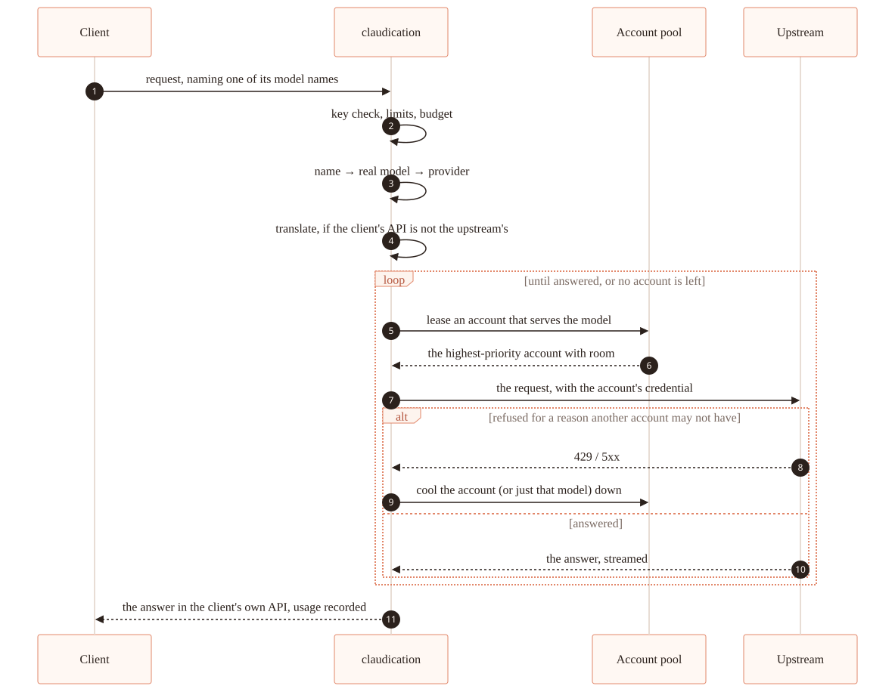

  

*claudication*, n. — a limp. In medicine, the kind caused by a narrowing that
starves the muscle under load: it comes on when you push, and eases when you
rest. Also contains Claude. The name is a promise about the failure mode — it
keeps walking, and it tells you where the narrowing is.

**A gateway that puts your Claude, ChatGPT and Google subscriptions behind the
APIs your tools already speak.** Point Claude Code, opencode or crush at its
Anthropic Messages API, Codex CLI at its OpenAI Responses API, or the
Antigravity CLI and gemini-cli at its Gemini API. The gateway signs in with your subscription accounts, pools
several of them in the order you choose, and relays requests byte for byte —
translating only where a client's API is not its upstream's. One static
binary, with the admin UI inside it.

  

- **Every client reaches every model.** Each tool is a *client* with its own
  key and model names — `large`, `small`, `review` — bound on its page to a
  real model or to the newest of a family. Which upstream serves a request is
  decided by the model the name resolves to, and the gateway translates
  between the APIs where they differ.
- **Subscriptions, pooled.** Accounts form a priority list per provider; the
  next takes over when one runs out of room, and each shows the same usage
  figures its own client does.
- **Run from a browser.** Accounts, clients, limits, the request log and every
  switch are in the admin UI, and nothing needs a restart.
- **Each client's agent can ask about itself**, over an MCP server behind its
  own key.

  
   
  Each API reaches each upstream: <b>as it came</b> (thick), <b>translated</b> (plain), or <b>through Messages</b> (dotted).

## Quick start

As root, on Alpine or Debian/Ubuntu — the same command installs and updates:

    curl -fsSL https://raw.githubusercontent.com/nebuloss/claudication/main/scripts/install.sh | sh

It installs the service, starts it, and prints the admin password once. Open
**http://your-gateway:8317/**, add an account under **Accounts**, and a client
under **Clients**: its page writes the tool's configuration with the
gateway's address, key and model names, and makes a one-line command that
installs it.

| Tool | API | Its configuration |
|---|---|---|
| Claude Code | Anthropic Messages | [`claude-code.sh`](configs/clients/claude-code.sh) |
| Codex CLI | OpenAI Responses | [`codex.toml`](configs/clients/codex.toml) + [`codex-models.json`](configs/clients/codex-models.json) |
| opencode | Anthropic Messages | [`opencode.jsonc`](configs/clients/opencode.jsonc) |
| crush | Anthropic Messages | [`crush.json`](configs/clients/crush.json) |
| Antigravity CLI | Gemini API | [`antigravity-cli.sh`](configs/clients/antigravity-cli.sh) + [`settings.json`](configs/clients/antigravity-cli.json) |
| gemini-cli | Gemini API | a custom client in direct mode: `GOOGLE_GEMINI_BASE_URL` and `GEMINI_API_KEY` |
| anything else | any of the three | a custom client: the key, the base URLs, and its model names |

Pinning a version, the listen address, running more than one, and the rest:
[docs/install.md](docs/install.md).

## Documentation

| | |
|---|---|
| [install.md](docs/install.md) | Installing, the first run, configuration, reverse proxies, exposing it safely, updating, backups, and building from source. |
| [accounts.md](docs/accounts.md) | Connecting Claude, ChatGPT and Google accounts, what each serves, and how their usage is read. |
| [clients.md](docs/clients.md) | Setting each tool up, and what each failure mode actually means. |
| [models.md](docs/models.md) | Model names, families, and where the gateway learns what a model can do. |
| [admin.md](docs/admin.md) | The admin UI, clients' keys and limits, and the request history. |
| [client-apis.md](docs/client-apis.md) | The three client APIs, how a request is routed and translated, and how to add another. |
| [relay.md](docs/relay.md) | What the relay changes on the way upstream, and what it must never break. |
| [refused-requests.md](docs/refused-requests.md) | Every way a request is refused for a reason it does not name, and how to find the next. |
| [deploying.md](docs/deploying.md) | How an update hands over to the new binary without refusing a connection. |
| [endpoints.md](docs/endpoints.md) | Every HTTP endpoint. |
| [docs/](docs/README.md) | The rest: what the official client sends, how it was all obtained, the public status page. |

  

## Before you use it

None of the three backends is a public API: they are what Claude Code, Codex
and Antigravity use with a subscription, and for Google accounts the gateway
presents itself as Antigravity, which is the only client Google still serves
them to. Pooling several people's subscriptions behind shared keys may breach
Anthropic's, OpenAI's or Google's terms and get accounts flagged — that is the
operator's decision to make knowingly. What was measured against each, and
how, is in `go doc ./internal/provider/anthropic`, `./internal/provider/openai`
and `./internal/provider/google`.

## Prior art

[auth2api](https://github.com/AmazingAng/auth2api) (TypeScript) and
[claude-code-proxy](https://github.com/fuergaosi233/claude-code-proxy) (Python)
solve the two halves separately. claudication is the union, rebuilt against the
official contract.
